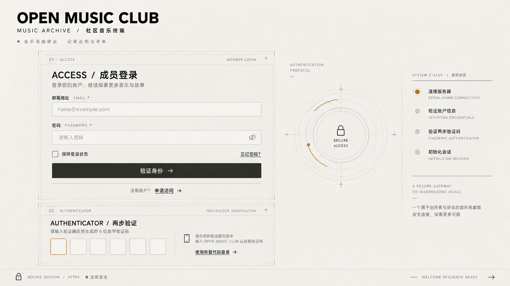
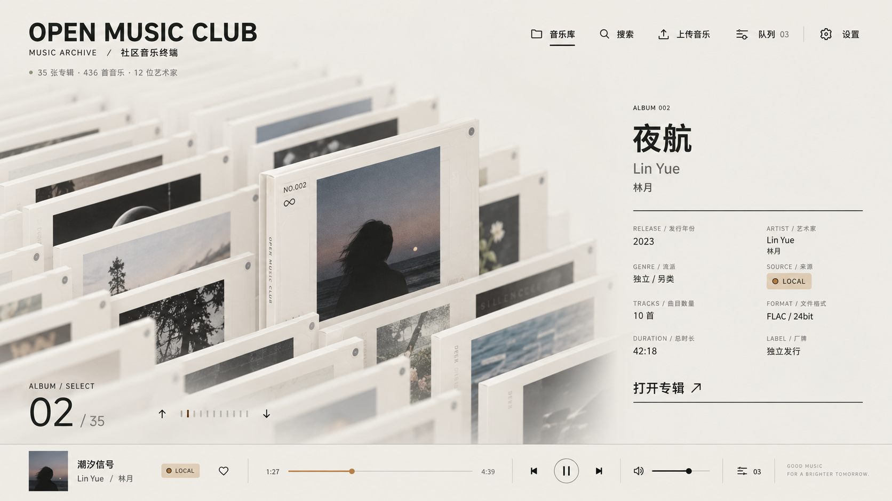
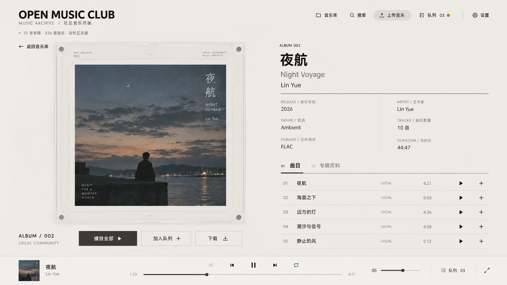
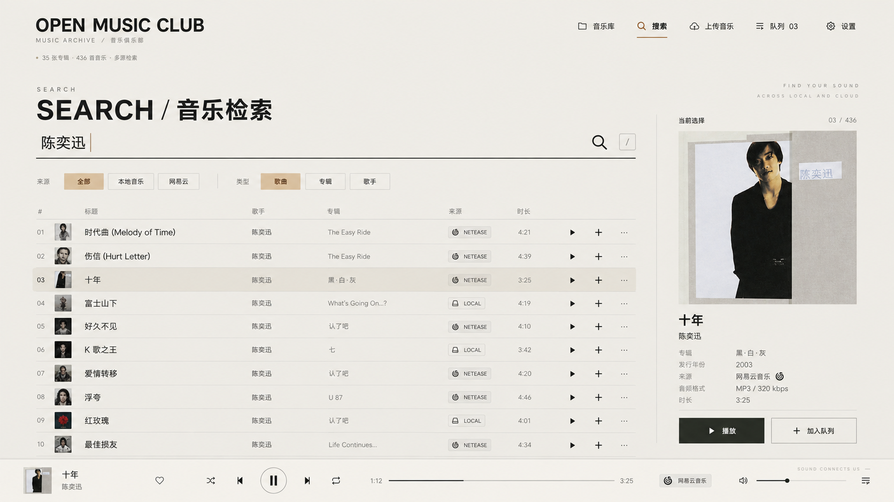
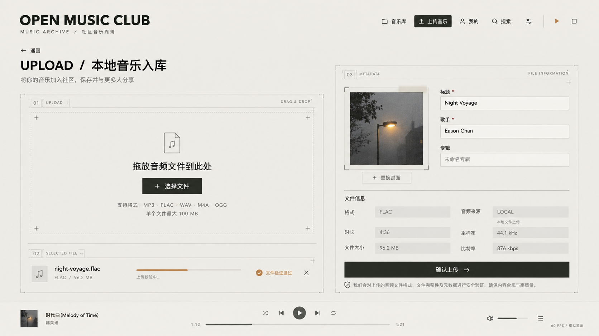
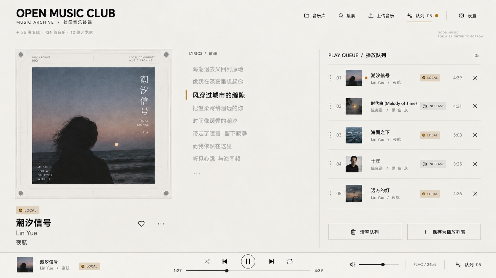
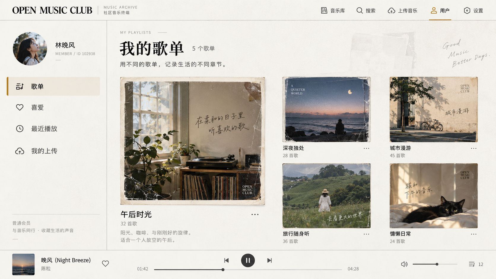

# Open Music Club 前端设计草案

> 状态：讨论稿，供后续人工修改和验收使用。
>
> 本文档记录当前已经讨论的视觉方向、页面结构和交互约束。文中的概念图用于确认布局与设计语言，不是最终像素稿；图片中的专辑、歌手、歌词和统计数字均为占位内容。

## 1. 设计目标

Open Music Club 前端以 RhineLabUI 的“研究档案终端”视觉语言和现有实现为基础，转换为音乐资料库，而不是制作成常见的卡片式音乐网站。档案墙及其交互优先复用原仓库的 Three.js 代码，再替换品牌、档案内容和音乐功能。

整体方向：

- 工业档案感与编辑式排版。
- 暖白背景、深色文字、细线分隔和克制的暖棕色强调。
- 保留大面积留白、中英文信息标签、滚动数字和档案编号。
- 本地音乐和网易云音乐在 API、存储及来源标识层保持独立。
- 两种来源在页面展示、播放队列和用户操作层使用统一的 `Track` 模型。
- 不为本地音乐和网易云音乐分别创建播放器。

## 2. 已确认的核心决策

### 2.1 保留与删除

保留：

- 原有启动画面的视觉节奏。
- 登录后的圆盘展开画面。
- Logo / `STAR` 和 `WELCOME TO` 画面。
- `WELCOME TO` 后进入档案墙的原有三维过渡与镜头运动。
- 基于 Three.js、WebGL 和 GLB 模型的三维档案墙、海浪式切换动画及原有档案选择交互。
- 档案终端式布局、解密式揭示过渡和专辑档案墙的空间感。
- 专辑详情的左右分栏结构。
- 搜索、设置和滚动数字等界面交互语言。

删除：

- 独立的“3D 档案拆解／模型查看”页面，以及该页面中的 360° 查看、清晰/磨砂、拆解、一键重组和视角复位功能。

删除范围仅限独立的拆解查看页面，不包括档案墙本身，也不包括进入档案墙和切换档案的三维动画。原仓库前端代码可作为实现基础，包括交互逻辑，但 Open Music Club 的品牌、音乐数据契约、登录状态和全站播放器仍按本文档适配；不直接搬入已删除页面。

### 2.2 专辑与歌曲

- 首页以“专辑档案”为主要视觉单位。
- 专辑封面是主要画面，歌手人物仅作为辅助资料。
- 单曲可以作为独立的“单曲档案”展示。
- 点击专辑进入曲目列表；真正进入播放器和队列的数据仍是统一 `Track`。
- 无封面音乐使用自动生成的排版封面，不使用普通灰色占位块。

### 2.3 全站播放器规则

- 登录页、2FA 和启动动画不显示播放器。
- 登录后的所有业务页面只使用一套播放器。
- 播放器始终固定在视口最下方。
- 各页面播放器高度、控件顺序、进度条位置保持一致。
- 页面主体中不得再出现第二套播放控制。
- 页面滚动时播放器保持可见，正文内容需要为播放器预留底部空间。
- 移动端缩为底部迷你播放器，点击后进入展开播放器。
- 右上角固定为“音乐库、搜索、上传音乐、用户、设置”；队列入口保留在底部播放器中，不再占用顶部导航。

## 3. 用户流程

```text
登录 / 2FA
    ↓
保留的启动画面
    ↓
Logo / STAR
    ↓
WELCOME TO
    ↓
沿用原仓库进入三维档案墙的过渡
    ↓
音乐档案主页
    ├─ 搜索
    ├─ 上传本地音乐
    ├─ 打开专辑
    ├─ 播放歌曲
    ├─ 打开用户页（歌单、喜爱、最近播放、我的上传）
    └─ 从底部播放器查看播放队列
```

登录成功后按原仓库的视觉节奏进入音乐档案主页；具体时长以原动画效果和实机体验校准，并提供跳过入口。跳过开场只跳过过渡，不绕过登录或直接进入已删除的拆解查看页面。

## 4. 全局页面框架

### 4.1 登录前

- 左上显示 `OPEN MUSIC CLUB` 品牌和系统副标题。
- 登录页面不显示音乐库、搜索、上传、队列和设置导航。
- 主体包含邮箱、密码、申请访问入口、2FA 和认证状态。
- 底部只显示安全会话及启动准备状态，不显示播放器。

### 4.2 登录后

桌面端顶部导航建议为：

```text
音乐库  /  搜索  /  上传音乐  /  用户  /  设置
```

底部固定播放器建议为：

```text
封面 + 歌曲信息 + 来源
        播放模式 / 上一首 / 播放暂停 / 下一首 / 循环
        已播放时间 + 进度条 + 总时长
        音量 + 音质 + 队列
```

## 5. 页面设计

### 5.1 登录与 2FA



页面要点：

- 右上角不显示任何业务导航。
- 登录表单和 2FA 可以处于同一视觉系统中，但实际交互按步骤显示。
- 初始状态只显示邮箱和密码；密码验证通过且用户启用 2FA 后再显示验证码步骤。
- 管理员正式部署到公网前必须启用 2FA。
- 错误信息显示在对应字段附近，不显示内部异常和服务器信息。
- 登录和 2FA 成功后再播放保留的启动画面。

### 5.2 音乐档案主页



主页以 Three.js 三维专辑档案墙作为核心记忆点，优先复用 RhineLabUI 的档案模型、镜头、渲染和交互实现：

- 左上显示品牌、专辑数、歌曲数和艺术家数。
- 右上为业务导航。
- 中央使用三维档案阵列与专辑封面形成档案墙，不以 CSS 卡片墙替代原场景。
- 当前专辑抬升并显示专辑名、歌手、年份、曲目数、总时长和来源。
- 左下显示当前专辑序号与总数。
- 沿用原项目的档案选择、镜头移动和海浪式切换逻辑，并适配键盘、鼠标滚轮、拖动、触摸和按钮操作。
- 底部播放器固定，不随档案墙移动。

Three.js 负责档案墙的模型、空间深度、相机和切换动画；普通 DOM/CSS 负责品牌、导航、专辑资料及固定播放器等界面层。原仓库中仅为拆解查看页面服务的模型和代码不属于本页面需求。

### 5.3 专辑详情



页面结构：

- 左侧显示大尺寸专辑封面和档案边框。
- 右侧显示专辑名称、歌手、年份、流派、格式、曲目数和总时长。
- 下方使用“曲目”和“专辑资料”页签。
- 曲目行包含序号、歌名、来源、时长、播放和加入队列操作。
- 同一首歌存在多个音源时，歌曲行显示版本数量；点击后直接在该行下展开本地文件格式、上传者和网易云来源供用户选择，不进入新的版本页面。
- 点击歌曲名称或主播放按钮时播放推荐版本；点击展开后的某个版本时播放用户明确选择的音源，同一时间只展开一首歌。
- 本地音乐可以显示下载操作。
- 上传者或管理员可以看到删除操作。
- 原来的“360° 查看模型”替换为“播放全部”和“加入队列”。

打开专辑时可沿用原项目从三维档案墙选中、抽出档案到详情页的过渡，再以界面层呈现专辑资料和曲目。该过程不进入独立的 3D 拆解查看页面。

### 5.4 搜索



搜索页面要点：

- 使用全屏档案索引布局，不使用普通卡片瀑布流。
- 支持“全部、本地音乐、网易云”来源筛选。
- 支持歌曲、专辑和歌手类型筛选；具体可用范围应以现有 API 能力为准。
- 本地音乐和网易云分别请求对应 API，前端只在结果展示层合并。
- 每条结果必须显示 `LOCAL` 或 `NETEASE` 来源标识。
- 点击歌曲直接播放，点击加号加入统一队列。
- 右侧信息栏显示当前选中结果的封面和资料。
- 底部继续使用全站固定播放器。

### 5.5 本地音乐上传



上传页面要点：

- 左侧为文件选择、拖放区域和验证进度。
- 右侧为 Metadata 和内嵌封面预览。
- 允许编辑标题、歌手和专辑。
- 来源固定为 `LOCAL`，客户端不可更改。
- 显示允许格式和最大体积，但最终安全校验必须由后端完成。
- 上传失败时给出对用户安全的错误提示，不显示内部文件路径和堆栈。
- 底部播放器仍保持固定，不因上传操作停止播放。

### 5.6 展开播放器与播放队列



页面主体分为：

- 左侧：当前歌曲封面、歌曲名、歌手、专辑和来源。
- 中间：歌词或歌曲资料。
- 右侧：播放队列。
- 最下方：唯一的全站播放器。

队列要求：

- 可以同时包含本地音乐和网易云歌曲。
- 每项显示来源标识。
- 支持调整顺序、移除和清空。
- 当前播放项使用克制的暖棕色标记。
- 切换页面不清空队列，也不中断播放。
- 队列中的歌曲可通过“加入歌单”操作保存到当前用户的自建歌单；播放队列本身仍是临时播放顺序，不自动等同于歌单。

### 5.7 用户页面与个人音乐库



本图用于确认布局和视觉层级；图中的头像、歌单封面、名称、数量和歌曲均是示意内容，不代表已存在的数据或已实现的接口。

- 顶部沿用业务页面的“音乐库、搜索、上传音乐、用户、设置”导航，当前“用户”项高亮；底部沿用唯一的全站播放器，队列入口仍在播放器右侧。
- 主体采用左 1/4、右 3/4 的分栏，左侧显示当前用户头像占位、昵称和四个入口：歌单、喜爱、最近播放、我的上传；右侧显示所选入口的内容。头像上传与个人资料编辑暂不属于本轮功能。
- “歌单”默认展示用户自己创建的歌单；提供新建歌单入口，并可进入歌单查看、重命名、删除和调整其中歌曲顺序。歌单卡片封面优先使用其歌曲封面组合，空歌单使用统一占位封面。
- “喜爱”展示当前用户收藏的歌曲，歌曲行可播放、加入队列、取消喜爱；本阶段收藏对象先限定为具体歌曲音源，不自动扩展到整张专辑。
- “最近播放”保留明确的页面入口与空状态；播放历史的持久化和回填需要单独验收，不能用浏览器临时队列冒充跨设备历史。
- “我的上传”复用现有本地音乐数据，按上传者筛选，仅展示本人上传的歌曲；管理操作仍以服务端权限为准。
- 空列表、歌曲被删除、网易云暂时不可用、未登录或会话失效均有清晰状态，不显示内部错误。切换四个入口不重建播放器，也不清空队列。
- 左侧入口是可扩展导航结构，后续可以加入其他个人功能；本轮不为未确定功能预建数据库字段或空接口。

从搜索结果、专辑曲目或播放队列点击“喜爱”时，心形状态与用户页同步。从播放队列点击“加入歌单”时，选择已有歌单或新建歌单后保存当前具体音源；本地和网易云相同 ID 不能混淆。同一歌曲的不同来源可分别保存，界面始终显示来源标识。

## 6. 统一 Track 与来源边界

播放器只消费统一 `Track`，例如：

```ts
interface Track {
  source: "local" | "netease";
  sourceId: string;
  trackKey: string;
  title: string;
  artists: Array<{ id: string | null; name: string }>;
  album: { id: string | null; name: string | null };
  durationMs: number;
  coverUrl: string | null;
  streamUrl: string | null;
  playable: boolean;
}
```

约束：

- `trackKey` 用于队列中的唯一识别，例如 `local:25` 或 `netease:123456`。
- 歌单项与喜爱项也使用 `source + sourceId` 引用具体音源，不存播放 URL；播放时仍交给统一播放器解析。
- 本地音乐使用 `/api/local/*`。
- 网易云音乐使用 `/api/netease/*`。
- 两种来源不能共用数据库表或后端业务逻辑。
- 统一只发生在前端展示模型、队列和播放控制层。
- 前端可以把确认属于同一录音的多个来源归为一首歌展示，但队列仍需记录实际选择的具体音源；无法可靠确认时保持为不同歌曲，避免错误合并。

## 7. 视觉系统

### 7.1 色彩

建议基础颜色：

```css
--surface: #f1efea;
--surface-soft: #e8e5df;
--text: #171915;
--text-muted: #77756d;
--line: #b9b5ab;
--accent: #a9783f;
--danger: #9c4035;
```

具体色值应在浏览器实机实现阶段继续校准。

### 7.2 排版

- 品牌标题使用宽体、粗体无衬线字体。
- 正文优先保证中英文可读性。
- 英文系统标签使用大写和较宽字距。
- 中文功能名称不使用过小字号。
- 不直接复制 Rhine Lab 品牌字体、Logo 或受许可限制的资源。

### 7.3 表面与控件

- 使用细线、编号、角标和档案边框建立层级。
- 控件以直角或轻微圆角为主。
- 避免常见 SaaS 大圆角卡片、彩色渐变和悬浮阴影堆叠。
- 来源标签保持克制，不使用过亮颜色。

## 8. 动效原则

- 动效用于说明状态变化，不作为装饰堆叠。
- 启动流程只保留一个主要记忆点。
- 专辑切换沿用原档案墙的海浪式运动、抬升和镜头反馈；幅度以可读性和性能为约束。
- 页面过渡采用短淡入、遮罩揭示和线条移动。
- 播放器切歌不改变播放器本身的位置。
- 支持 `prefers-reduced-motion`；减少动态效果时直接显示最终状态。

## 9. 响应式方向

### 桌面端

- 保留非对称左右分栏和大面积留白。
- 播放器固定在底部并横向展开。

### 平板端

- 缩小专辑档案墙的层数。
- 详情页允许上下分区，但播放器仍固定在底部。

### 手机端

- 优先评估原三维档案墙在移动端的交互和性能；若设备不支持 WebGL 或性能不足，可降级为封面栈或纵向列表。
- 顶部导航折叠为菜单。
- 底部使用迷你播放器。
- 展开播放器后单独显示歌词和队列。
- 使用安全区域，避免遮挡系统手势条。

## 10. 无障碍与安全要求

- 所有按钮提供明确的文本或 `aria-label`。
- 键盘可完成搜索、切换歌曲、播放、暂停和关闭弹窗。
- 焦点状态不能只依赖颜色。
- 封面图片提供合适的替代文本。
- 页面不能把后端错误堆栈、路径、Session、2FA 密钥或上游错误直接显示给用户。
- 前端请求使用相对地址并携带本站 Session；不在浏览器保存密码和 2FA 密钥。
- 不通过前端代码判断管理员权限，管理员操作最终必须由后端验证。

## 11. 建议实施顺序

每轮只完成一个可以独立验收的功能：

1. 建立视觉 Token、基础排版和页面外壳。
2. 实现登录页面，不接启动动画。
3. 接入现有登录 API 和 2FA 流程。
4. 复用原项目启动动画并适配登录后的跳过逻辑。
5. 复用 Three.js 三维档案墙、海浪切换和档案选择交互，替换为专辑内容；不接入独立拆解查看页面。
6. 实现专辑详情和曲目列表。
7. 实现全站固定播放器和统一队列。
8. 实现本地/网易云搜索。
9. 实现本地音乐上传页面。
10. 实现用户页分栏和四个入口的视觉/空状态。
11. 分别实现“新建与管理歌单”“队列歌曲加入歌单”“歌曲喜爱及列表”，每轮单独验收；“我的上传”复用现有数据。
12. 另行决定并实现最近播放持久化，再接入该入口。
13. 实现响应式、主题和无障碍细节。

## 12. 待继续确认

- Open Music Club 最终 Logo 与品牌副标题。
- 档案主页一次展示多少张专辑。
- 首页专辑集合的排序规则。
- 单曲缺少专辑时的归类方式。
- 歌单是否支持公开分享、协作和自定义封面；当前仅规划私有歌单。
- 喜爱是否扩展到专辑；当前仅规划具体歌曲音源。
- 最近播放的保留时长和跨设备同步策略。
- 展开播放器是否保留歌词区域。
- 播放队列是否需要跨设备/跨会话持久化；当前与已持久化的用户歌单分开。
- 暖昼/深夜主题是否第一版同时开发。
- 启动画面每次登录都播放，还是每个 Session 只播放一次。
